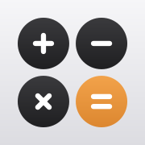

# Calculator

A clean, simple calculator for iPhone, built as a home screen web app.
No App Store, no account, no tracking — just open it in Safari and add it to your home screen.

**▶ Live app:** https://hoh57.github.io/calculator/



## Install on iPhone

1. Open **https://hoh57.github.io/calculator/** in **Safari**.
2. Tap **Share** → **Add to Home Screen** → **Add**.
3. Open it from the home screen icon. It runs full screen and works offline after the first open.

## Features

### Keypad
- AC, +/−, %, ← (backspace), ⠿ (scientific), 🗑 (clear), ≡ (settings), tall =
- Keys grow and lighten while pressed
- × and ÷ are done before + and −
- No floating-point junk: `0.1 + 0.2 = 0.3`
- Very long answers never get cut off: the text shrinks to fit, and past 16 digits the answer is shown short, like `1.5e21`

### Copy and Paste
- **Long-press the number** to get Copy | Paste
- Copy gives the answer (or the number on screen) without thousands commas, so it pastes into any app
- Paste accepts a number such as `1,234.50`, `RM 99` or `$5`; anything else is refused with "No number to paste"
- iPhone shows its own small "Paste" bubble to confirm; that comes from iOS and can't be skipped
- With a keyboard: Ctrl/Cmd+C and Ctrl/Cmd+V

### Percent (%)
The % stays on screen and in the history (e.g. `100−6% = 94`).

| You type   | Result | Why                         |
|------------|--------|-----------------------------|
| `100−6%`   | 94     | 6% of 100, taken off        |
| `100−%6`   | 94     | % can go before the number  |
| `200×10%`  | 20     | 10% of 200                  |
| `80÷10%`   | 800    | 80 ÷ 0.1                    |
| `50%`      | 0.5    | plain percent               |
| `100−6%×2` | 99.88  | more follows, so 6% = 0.06  |

← deletes just the %, and a second % is ignored.

### Scientific panel (⠿)
2nd, sin / cos / tan and inverses, sinh / cosh / tanh and inverses, logᵧ, log₂ / 2ˣ, ln / eˣ, log₁₀ / 10ˣ, x!, √, ∛, ʸ√x, e, π, Rand, x², x³, xʸ, ( ) and a Deg/Rad switch (Deg by default).

- A function applies to the number you just typed (`30 sin` → `sin(30)`); otherwise it opens `sin(`.
- `2π` and `2(3+4)` multiply automatically. Missing `)` are closed when you press =.

### History
- Tape grouped by date; tap a past answer to reuse it
- Full Screen history view (the pill appears while you scroll)
- 🗑 tap clears the number and history; **long-press 🗑** brings the last cleared history back
  (the history fades back in and the 🗑 key flashes brighter; no vibration on a long press)

### Keeps your sum
The sum you are typing is saved as you go. If the app is closed by accident, it is back on screen
when you reopen it, ready to continue. It is not added to the history. AC clears it, and an Error is not kept.

### Settings (≡)
- History on/off
- Keyboard Vibration on/off
- Decimal Places: Unlimited, or fixed 0–5 (e.g. `10.00`)
- Appearance: Light, Dark or Follow System
- Theme: Classic, Sakura, Lavender, Navy or Forest (each has a light and a dark version)
- Version: the version you are running, on the last line

Follow System on a home screen app only switches after the app is fully closed and reopened
(an iOS bug); in Safari it switches straight away. The home screen icon stays the same for every theme.

## Privacy

History, settings and the sum you are typing are saved only on your phone (browser storage). Nothing is sent anywhere.

## What's new

See [CHANGELOG.md](CHANGELOG.md).

## Project files

| File                   | What it is                                           |
|------------------------|------------------------------------------------------|
| `index.html`           | The whole app: layout, styles and logic in one file  |
| `sw.js`                | Service worker — keeps the app working offline        |
| `manifest.webmanifest` | App name, colours and icons for "Add to Home Screen" |
| `icon-*.png`           | App icons (180 for iPhone, 192/512 for others)       |
| `sitemap.xml`          | Tells search engines (Google Search Console) the page address |
| `test.js`              | Maths tests — presses the real keys and checks the answers (`node test.js`) |

No build step and no libraries — it is plain HTML, CSS and JavaScript.

## Making changes

1. Edit the files and push to `main`. GitHub Pages serves the repo root.
2. On every push that changes the app, pick the new version number (see *Versioning* below) and put it in **three places**:
   - `CACHE` in `sw.js` (e.g. `calc-1.0.0` → `calc-1.1.0`)
   - the **Version** line in Settings (`index.html`)
   - a new section at the top of `CHANGELOG.md`

   Phones show the new version on the **first** open after the push: the app downloads it in the background and
   reloads itself after a few seconds (straight away if no key was pressed yet, otherwise when the app is next put away).
   The sum being typed is saved, so the reload loses nothing.
3. The release is automatic: when `sw.js` gets a new version, a GitHub Action
   (`.github/workflows/release.yml`) creates tag `v1.2.3` and release `1.2.3` with that version's CHANGELOG notes,
   and the repo page shows it as *Latest*. So write the CHANGELOG section **before** or in the same push.
4. Run `node test.js` before pushing (no install needed). GitHub runs it too on every push
   (`.github/workflows/test.yml`), and a version is not released if a check fails. When you change how a key
   works, add a line for it in `test.js`.

### Versioning
The version has three numbers, **MAJOR.MINOR.PATCH** (e.g. `1.2.3`):

| Change | Bump | Example |
|---|---|---|
| Big change to how the app looks or works (a redesign, removing a feature) | MAJOR, reset the others | 1.4.2 → 2.0.0 |
| New feature or new setting (a theme, a new key, the version line) | MINOR, reset PATCH | 1.4.2 → 1.5.0 |
| Fix or small tweak to something that already exists (a bug, a timing, a colour) | PATCH | 1.4.2 → 1.4.3 |

- Several changes in one push: use the biggest one.
- Docs-only pushes (README, CHANGELOG) don't change the version or the cache.

To test on a computer, serve the folder locally (a service worker needs http, not `file://`):

```sh
python3 -m http.server 8000
# then open http://localhost:8000
```

### iPhone quirks — keep these
- Status bar meta must be `black`, not `black-translucent` (translucent cut off the bottom of the app).
  Changing it needs the home screen icon deleted and re-added.
- Don't force `height:100vh` in standalone mode — it clipped the bottom row.
- Haptics: iOS blocks vibration started from code, so each key has an invisible
  `<input type="checkbox" switch>` the finger flips for real. A long press never ticks.
- Keys act on `pointerdown` (fast taps were dropped with `click`); 🗑, ≡ and ⠿ act on release.
- History must open at the newest line: iOS settles the home screen layout after first paint, so a
  `ResizeObserver` on the tape (plus `pageshow`) scrolls to the bottom again whenever its size changes.
- Setting `scrollTop` doesn't stop a flick that is still gliding. Every jump to the newest line goes
  through `toBottom()`, which briefly sets `overflow-y:hidden` to kill the momentum, then restores it.

### How themes work
- Saved in `calc-settings` as `theme` + `mode`. The page sets `data-theme="<theme>-<light|dark>"` on `<html>`.
- Theme CSS only swaps variables on `:root[data-theme=…]`. Keep it scoped to `:root` — the theme
  buttons in Settings also carry `data-theme`. `classic-dark` has no rule: it is the default look.
- A small script in `<head>` applies the saved theme before first paint (no colour flash) and
  defines `OLD_THEMES`, `lightMode` and `themeAttr()`, which the main script reuses.
- `OLD_THEMES` maps older saved theme names (auto, blush, slate, peach, carbon, …) to a current
  theme + mode, so phones that saved an old choice still get a matching look. Don't remove it.
- The `theme-color` and `color-scheme` meta tags are read from the applied CSS (`--bg`, `color-scheme`).

## License

[MIT](LICENSE)
